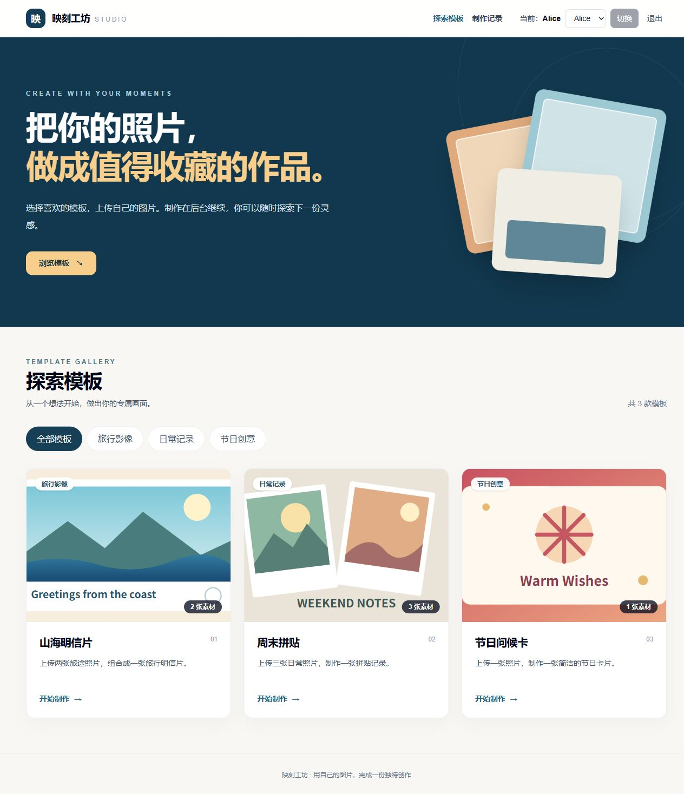
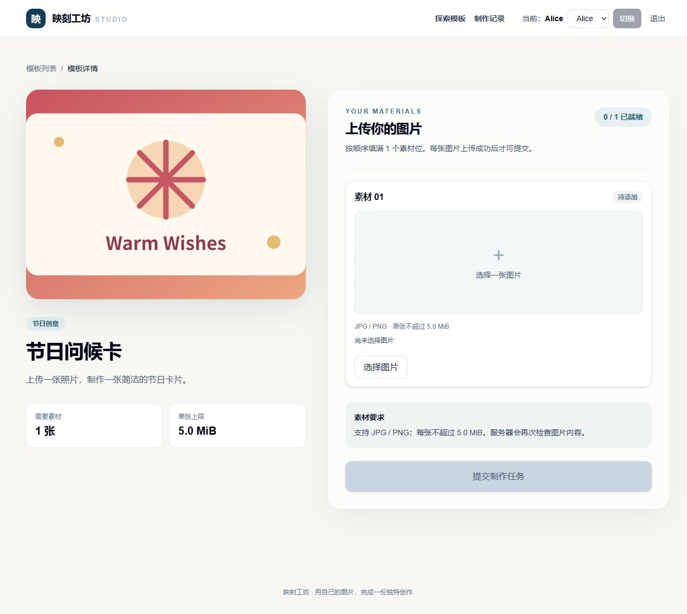
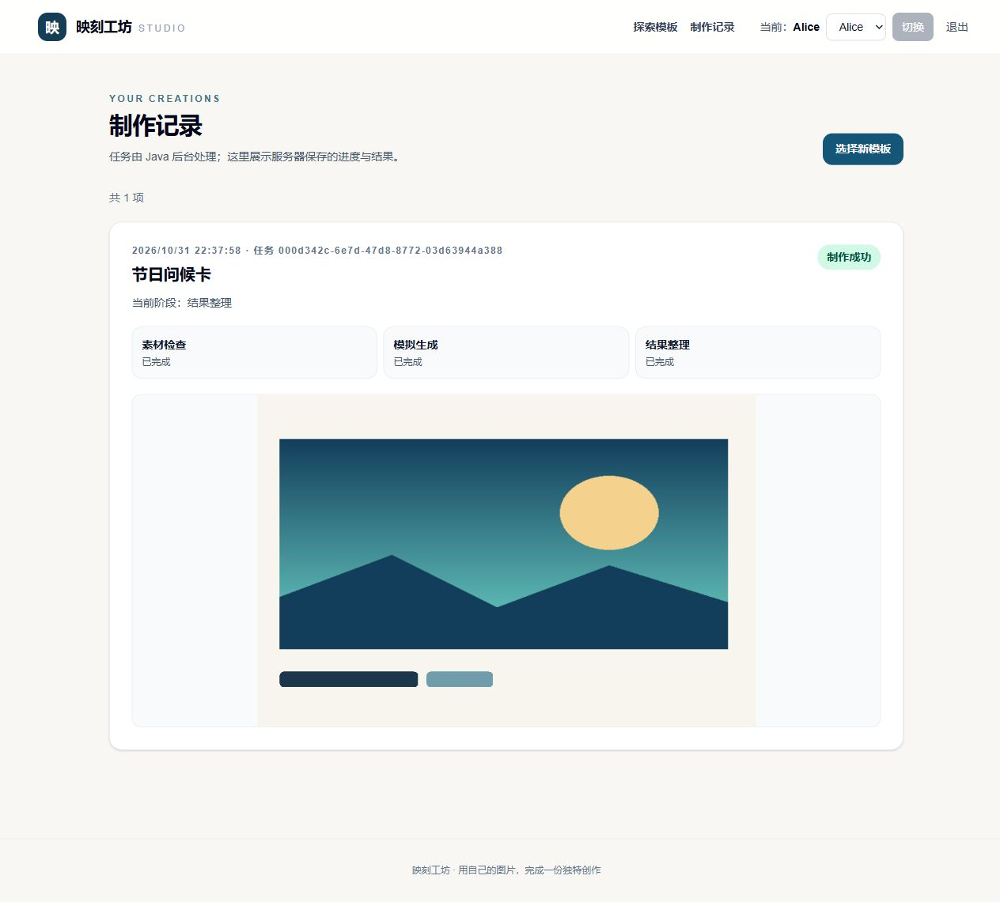

# 素材制作站

小影科技全栈开发笔试题的单仓库项目：Next.js 展示模板、上传和历史；Java 受理任务并在后台按三个阶段处理；MySQL 保存身份、素材和任务记录。2026-10-31 已在 Ubuntu 虚拟机启动 Compose，并从 Windows 浏览器实际完成 Alice 登录、单图上传、任务成功、结果预览、刷新恢复及 Bob 页面隔离。后端最新版 Maven verify 实测 31 项中 1 项失败，测试断言已修订但尚未复跑；三种指定失败的 HTTP 演示、数据卷重启保留和 GitHub Actions 仍待验证。接口与状态以 [API 契约](docs/api-contract.md) 为准。

## 运行截图

以下截图来自 Windows 浏览器访问 Ubuntu 容器中的站点，使用演示用户和仓库自绘素材；不是部署在公网的服务。







另见[分类筛选](docs/screenshots/06-category-filter.png)、[上传就绪](docs/screenshots/03-upload-ready.png)及[Bob 的空历史](docs/screenshots/05-bob-empty-history.png)。截图只能证明展示时的页面状态；具体运行证据见下文。

## 技术版本与目录

版本以 [前端包清单](frontend/package.json)、[npm 锁文件](frontend/package-lock.json)、[后端 POM](backend/pom.xml)、[Maven Wrapper 配置](backend/.mvn/wrapper/maven-wrapper.properties) 和 Dockerfile 为准。前端容器检查和 Compose 页面链路已运行；最新后端测试门槛仍未通过。

| 层 | 固定版本或来源 |
| --- | --- |
| 前端运行时 | Node.js **22.23.4**；Next.js **16.4.3** App Router；React / React DOM **19.3.1**；TypeScript **5.9.3**，strict 模式 |
| 前端样式与状态 | Tailwind CSS / PostCSS 插件 **4.1.10**；TanStack Query **5.90.10** |
| 前端检查 | ESLint **9.34.0**、eslint-config-next **16.4.3**、Vitest **3.2.4**、React Testing Library **16.3.0** |
| 后端运行时 | Eclipse Temurin Java **21.0.12.1+1**（镜像标签 `21.0.12.1_1`）；Spring Boot **3.5.16**；MyBatis Spring Boot Starter **3.0.5** |
| 数据与构建 | MySQL Server **8.4.11**、Connector/J **26.10.0**、Flyway Core/MySQL **11.7.2**（Spring Boot 3.5.16 BOM 管理）；后端容器构建镜像 Maven **3.9.11** + Temurin **21**；仓库 Maven Wrapper **3.3.4** 指向 Maven **3.9.11** |

Flyway **11.7.2** 来自 [Spring Boot 3.5.16 BOM 元数据](https://central.sonatype.com/artifact/org.springframework.boot/spring-boot-dependencies/3.5.16)，并非本机 Maven 解析结果；其他 Maven 托管依赖也由该 BOM 选版。前端直接与传递依赖由 `package-lock.json` 记录；Maven 工程没有独立锁文件。基础镜像使用补丁标签，尚未固定 digest。

~~~text
frontend/           Next.js App Router 页面、组件、同源 /api/** 代理、Vitest 测试
backend/            Spring Boot Controller/Service/Worker、MyBatis Mapper、Flyway、JUnit 测试
backend/src/main/resources/db/migration/  V1 七表、V2 模板、V3 演示用户
backend/src/main/resources/demo/covers/  三张原创 SVG 模板封面
demo-inputs/        coast.png、sunset.jpg 演示上传素材
scripts/            容器内 HTTP 冒烟脚本
.github/workflows/  push/PR CI
docs/               契约、设计、开发日志与验证记录
compose.yaml        db/backend/frontend 与 test/smoke profile
~~~

## 容器启动与配置

`frontend/` 为 Next.js；`backend/` 为 Java；`compose.yaml` 编排数据库、后端和前端。只发布前端宿主端口，Java 和 MySQL 留在 Compose 网络。数据库和素材使用命名卷。

在具备 Docker Compose 的隔离环境，从项目根目录运行。Ubuntu 虚拟机已执行 `docker compose up --build -d --wait` 并能从 Windows 浏览器访问；完整自动冒烟未运行：

```sh
cp .env.example .env
docker compose --profile test --profile smoke config --quiet
docker compose up --build -d --wait
docker compose ps
docker compose --profile smoke run --rm smoke
```

推送或 PR 触发的 [GitHub Actions](.github/workflows/ci.yml) 配置了前端 lint/类型检查/Vitest/build、连接 MySQL 8.4 的 Maven verify、完整 Compose 启动、HTTP 冒烟及正常 down/up 的卷保留检查。可复现命令和结果见[容器验收记录](docs/container-acceptance.md)。Ubuntu 虚拟机中的前端检查已完成 lint/typecheck、Vitest 35/35 与 build；后端镜像最新已构建并运行真实 MySQL verify，结果为 **31 项中 1 failure、0 errors、0 skipped**。该失败是测试只接受 `DataIntegrityViolationException`，而 MySQL CHECK 约束错误被 Spring 包装为 `UncategorizedSQLException`；测试已改为直接核对 MySQL 错误码与约束名，尚未复跑。新版应用已通过下述手工主流程，CI 仍无核实通过记录。

默认本机访问 `http://127.0.0.1:3000`。本次 Ubuntu 虚拟机将 `WEB_BIND_ADDRESS` 设为虚拟机 host-only IP `192.168.56.101`，Windows 浏览器实际访问 `http://192.168.56.101:3000`；VM 地址变化时需同步改 `.env` 的 `WEB_BIND_ADDRESS` 与 `APP_ALLOWED_ORIGINS`。Compose 只把前端 3000 映射到宿主，Java 8080 与 MySQL 3306 留在内部网络。浏览器只请求同源 `/api/**`；Next.js 服务端以**运行时** `JAVA_API_ORIGIN=http://backend:8080` 代理 Java，Java 连接 `db:3306`。代理保留方法、multipart/图片流、Cookie、`Set-Cookie`、`Location`、`Content-Type`、上游状态与取消信号，不缓存私有响应。上游地址不取自客户端。

[.env.example](.env.example) 只含本地演示值，没有真实凭据；`.env` 已被忽略。主要配置如下：

| 变量 | 示例值 | 用途 |
| --- | --- | --- |
| `WEB_BIND_ADDRESS`, `WEB_PORT` | `127.0.0.1`, `3000` | 前端宿主监听地址/端口 |
| `MYSQL_DATABASE`, `MYSQL_USER`, `MYSQL_PASSWORD`, `MYSQL_ROOT_PASSWORD` | `material_studio`, `material_app`, `local_demo_password`, `local_demo_root_password` | 数据库初始化与 Java JDBC 连接；实际部署须更换密码 |
| `JAVA_API_ORIGIN` | `http://backend:8080` | 仅 Next.js 服务器读取的 Java 上游 |
| `STORAGE_ROOT` | `/data/assets` | Java 文件根目录；Compose 将 `asset-data` 卷挂载到相同路径 |
| `DEMO_MODE`, `TASK_WORKER_ENABLED` | `true`, `true` | 演示身份/模拟控制与单实例 Worker 开关 |
| `DEFAULT_STAGE_DELAY_MS` | `2000` | 每阶段默认模拟毫秒数，合法范围 0～30000 |
| `SESSION_TTL_HOURS`, `SESSION_COOKIE_SECURE` | `24`, `false` | 会话有效期（代码限制 1～168 小时）；HTTPS 时将 Secure 设为 true |
| `APP_ALLOWED_ORIGINS` | `http://127.0.0.1:3000,http://localhost:3000` | Java 对非 GET/HEAD/OPTIONS 请求检查的精确 Origin 白名单 |
| `MAVEN_MIRROR` | `central` | 后端镜像构建时的 Maven 下载源；可设为 `aliyun` 使用阿里云 Central 镜像，仅影响构建/测试镜像 |

容器环境中的项目检查命令：前端执行 `docker compose --profile test run --build --rm --no-deps frontend-test`（依次 lint、typecheck、Vitest、build）；后端执行 `docker compose --profile test run --build --rm backend-test`（Maven verify，连接隔离的 MySQL 8.4）。第三次 Ubuntu 容器前端检查已完成全部步骤；最新后端 verify 运行 31 项，其中 1 failure、0 errors，**尚未通过**。先前的 Maven Wrapper 和 Maven Central 下载问题已被绕过，当前测试镜像能够构建并进入真实 MySQL 测试。后端测试入口把完整日志和 Surefire 报告写入被忽略的 `backend-test-output/`，以便定位；见 [前端验证记录](docs/frontend-verification.md)和[后端验证记录](docs/backend-verification.md)。

后端 Dockerfile 使用 BuildKit Maven 仓库缓存、Resolver HTTP 重试和 `-U`，并将成功构建时的依赖带入测试镜像。默认仍从 Maven Central 下载；在网络持续截断的环境，可在本地 `.env` 设 `MAVEN_MIRROR=aliyun` 后执行同一构建命令，镜像地址为 `https://maven.aliyun.com/repository/central`。Ubuntu 已用这份本地配置构建测试镜像并执行 `verify`；测试仍有上述 1 项失败，不得称为通过。

## API 契约与会话

以下均从同源前端端口请求 `/api/**`，由 Next.js 原样代理给 Java；内部 Actuator 健康接口另见下表。方法、字段以 Java DTO 和 [API 契约](docs/api-contract.md) 为准。公开 ID 为 UUID，JSON 用 camelCase，时间为 UTC ISO 8601；未发生的时间、结果和失败字段为 `null`。

| 方法与路径 | 请求字段 | 成功响应 |
| --- | --- | --- |
| `GET /api/health` | 无 | `200 {"status":"UP"}` |
| `GET /api/templates?category=名称` | `category` 可省略，精确分类 | `200 Template[]`，无匹配为 `[]` |
| `GET /api/templates/{id}` | 模板 UUID | `200 Template`；不存在 404 |
| `GET /api/templates/{id}/cover` | 模板 UUID | `200 image/svg+xml`，公开原创封面 |
| `GET /api/demo-users` | 无；只在 `DEMO_MODE=true` 可用 | `200 DemoUser[]`，关闭演示模式时 404 |
| `POST /api/session` | JSON `{"demoUserKey":"alice"}` | `200 User` + `Set-Cookie: material_session=...` |
| `GET /api/session`、`DELETE /api/session` | 会话 Cookie | 分别为 `200 User`、`204` 并清 Cookie |
| `POST /api/assets` | multipart：一个 `templateId`、一个 `file` | `201 Asset` |
| `GET /api/assets/{id}/content` | 会话 Cookie | `200` JPEG/PNG 私有图片流；他人或不存在为 404 |
| `POST /api/tasks` | JSON `{"templateId":"...","assetIds":["..."],"simulation":{...}}`；`simulation` 可省略 | `202 Task` + `Location: /api/tasks/{id}`，不等待后台生成 |
| `GET /api/tasks/{id}`、`GET /api/tasks` | 会话 Cookie | 分别为 `200 Task`、`200 Task[]`；只读、仅本人，列表按 `createdAt DESC,id DESC` 返回全部 |
| `GET /actuator/health` | 仅 Compose 内部调用 Java | Spring Actuator 健康响应 |

`Template` 字段：`id,title,category,coverUrl,description,requiredImageCount,acceptedMimeTypes,maxFileSizeBytes`。`DemoUser` / `User` 字段：`id,demoUserKey,displayName`。`Asset` 字段：`id,previewUrl,mimeType,sizeBytes,width,height`，不返回磁盘路径。`Task` 字段：`id,templateId,templateTitle,status,stage,createdAt,startedAt,finishedAt,resultUrl,failedStage,errorCode,errorMessage,version,steps`；每个 `TaskStep` 有 `stage,status,startedAt,finishedAt,errorMessage`。所有非成功响应统一为 `{"code":"...","message":"...","traceId":"..."}`，不含堆栈或磁盘路径。Java 不可达时代理返回 502 同形错误体，**这不是任务制作失败**。

`material_session` 由 Java 使用 32 字节安全随机数生成，浏览器通过 `Set-Cookie` 保存；令牌只放在 HttpOnly、SameSite=Lax、Path=/ Cookie，数据库只存 SHA-256 摘要和过期时间。用 API 客户端调用时需保留 Cookie；所有 POST/PUT/PATCH/DELETE 还必须发送与 `APP_ALLOWED_ORIGINS` 完全匹配的 `Origin`（本地为 `http://127.0.0.1:3000`）。资源归属由 Java 会话推导，不能在请求中提交 `userId`。无有效会话为 401，别人的任务、上传图和结果图与不存在资源一样返回 404。

## 当前前端页面

- `/` 从 Java 读取模板与分类，支持按分类筛选、加载/空数据/404/服务错误和手动重试；封面使用仓库内原创 SVG。
- `/templates/{id}` 按 `requiredImageCount` 显示上传位，支持选择、预览、替换、移除、进度与错误。客户端先检查 MIME/扩展名/大小，Java 保持最终校验权；成功上传后只用返回的 `assetId` 提交。
- 顶栏从 Java 查询演示身份并切换会话。切换时取消、清理旧用户私有查询和上传请求；401 与临时服务故障分别提示。提交返回 202 后立即退出提交状态，将完整任务快照按 `userId/taskId` 写入缓存并刷新历史，上传位可继续创建下一任务。
- `/history` 从 Java 读取当前用户完整任务列表，展示创建时间、模板、状态、当前/失败阶段、三个步骤、错误原因和授权结果图片；刷新浏览器后重新从 Java 恢复。图片读取失败可单独重试。

历史列表使用 TanStack Query v5，查询键包含 `userId`。有 `QUEUED/RUNNING` 时约每 2 秒查询一次；所有任务终态后停止。列表不做固定条数截断，按 `id` 合并任务，低 `version` 或迟到的运行态响应不能覆盖较新/终态快照。请求使用 `AbortSignal`；切换用户清除旧用户缓存。GET 的 500/503/超时仅作为请求错误，保留旧任务并提供手动重试，不把任务写成 `FAILED`；401 才视为会话失效。查询错误后暂停自动轮询，手动重试成功后按活跃任务恢复。提交 POST 超时或网络中断时，服务端可能已经受理；页面不自动重发，请先刷新 `/history` 核对。当前没有受理幂等键，这是为控制本题范围的取舍。相关前端行为用例包含在已通过的 35 项 Vitest 中；真实网络异常场景尚未手工演示。

## 演示身份、模板与种子

空 MySQL 数据库启动时，Spring Boot 自动运行 Flyway：`V1__schema.sql` 创建 `users`、`sessions`、`templates`、`assets`、`tasks`、`task_assets`、`task_steps` 七张业务表及约束/索引；`V2__seed_templates.sql` 写入旅行影像（2 图）、节日创意（1 图）、日常记录（3 图）三个分类；`V3__seed_demo_users.sql` 写入 Alice/Bob。已有数据库由 `flyway_schema_history` 校验已应用版本，**不要修改已应用迁移**。本次运行从 Java 接口实际读到了三模板和 Alice/Bob，并成功写入/读取任务与素材；未独立查询 `flyway_schema_history`，也未实测空卷从零初始化。

三个原创 SVG 封面随 Java JAR 资源打包，由 `/api/templates/{id}/cover` 公开读取。`demo-inputs/coast.png` 与 `sunset.jpg` 是仓库内自绘 640×400 演示上传图；本次已通过页面将 `coast.png` 上传至 Java，取得素材 ID，并生成可加载的 900×600 结果图。Compose 用 `mysql-data` 保存 MySQL 数据，用 `asset-data` 挂载 `STORAGE_ROOT` 保存上传和结果图片，另有仅供冒烟 ID 使用的 `smoke-state` 卷。文件先写 `STORAGE_ROOT/tmp`，验证后移动到 `STORAGE_ROOT/uploads`；数据库仅存相对路径与归属。正常 `docker compose down` 不删除命名卷，`down --volumes` 会删除它们；卷保留行为仍待实测。

演示用户为 `alice` 和 `bob`。`POST /api/session` 只接收 `demoUserKey`，Java 查询用户并生成 32 字节安全随机令牌；数据库只存 SHA-256 摘要和 UTC 过期时间。业务时钟使用 `Instant`，MyBatis 写入 `DATETIME(6)` 前显式转成 UTC `LocalDateTime`。Cookie 为 `HttpOnly; SameSite=Lax; Path=/`，HTTPS 部署需设置 `SESSION_COOKIE_SECURE=true`。所有 `/api/**` 的 POST/PUT/PATCH/DELETE 必须带与 `APP_ALLOWED_ORIGINS` 完全匹配的 `Origin`；本地默认允许 `127.0.0.1:3000` 与 `localhost:3000`。设 `DEMO_MODE=false` 后，`GET /api/demo-users` 和 `POST /api/session` 均返回 404。**演示身份不等同于正式认证**；上线需另行实现真实身份、会话治理和生产密钥管理。

成功登录只返回 `{id,displayName,demoUserKey}`，明文令牌仅在 `Set-Cookie` 中。模板列表按分类精确筛选，无匹配项返回 `[]`；非法分类或 ID 返回 400，不存在的模板返回 404。可复制的容器内演示步骤见下文。

## 素材上传与私有读取

演示图片和来源见 [demo-inputs](demo-inputs/README.md)。

上传成功返回 `201` 和 `{id,previewUrl,mimeType,sizeBytes,width,height}`；`previewUrl` 是同源且需会话的私有图片入口，不返回磁盘路径。Bob 用自己的 Cookie 请求 Alice 的图片返回与不存在图片相同的 404。每次上传请求只包含一张图；模板要求的精确张数在任务受理时校验，允许用户替换后重新上传。当前没有删除已上传素材的接口。

Java 校验模板 MIME 和大小限制，并统一限制为 JPEG/PNG、单张不超过 5 MiB、像素不超过 2000 万；还核对扩展名、请求 MIME、文件头尾标志和完整解码。空图返回 `400 EMPTY_FILE`，伪装/坏图返回 `415 INVALID_IMAGE`，超大返回 `413 FILE_TOO_LARGE`。新文件先写入 `STORAGE_ROOT/tmp`，再移入 `STORAGE_ROOT/uploads`，数据库只存相对路径；写库失败尽力删除新文件。数据库和文件系统不是同一事务，进程在移动与提交之间中断仍可能留下孤儿文件。私有图片按会话查 `id AND user_id`、校验路径在上传目录内后流式返回，带 `Cache-Control: private, no-store` 和 `nosniff`。模板封面仍由公开的模板接口提供。

## Java 任务与 Worker

`POST /api/tasks` 接收 `templateId`、按槽位排序且不重复的 `assetIds` 和可省略的 `simulation`；通过会话确定用户，并在受理前检查每张素材的归属、模板、MIME、大小和磁盘可读性。一个短事务写入 `QUEUED` 任务、素材顺序和三条 `PENDING` 步骤；返回 `202`、任务快照及 `Location: /api/tasks/{id}`。`GET /api/tasks/{id}` 与 `GET /api/tasks` 只查询本人记录；历史按 `createdAt DESC,id DESC` 返回全部，不推进任务。

| 任务状态 | 含义与后继 |
| --- | --- |
| `QUEUED` | 已受理；等待 Worker，`stage=null`；可转 `RUNNING` |
| `RUNNING` | 已领取；依次执行 `ASSET_CHECK → GENERATE → FINALIZE`；可转 `SUCCEEDED` 或 `FAILED` |
| `SUCCEEDED` | 终态；`resultUrl` 指向会话授权图片 |
| `FAILED` | 终态；保存 `failedStage,errorCode,errorMessage`，无结果 URL |

每个阶段步骤的状态为 `PENDING/RUNNING/SUCCEEDED/FAILED/SKIPPED`。失败事务把当前步骤标 `FAILED`、其后未开始步骤标 `SKIPPED`；任务 `version` 随阶段边界增加，查询不推进状态，也不把终态改回运行态。

单实例 Worker 每约 500 ms 查询最早 `QUEUED`，再以 `UPDATE ... WHERE status='QUEUED'` 检查影响行数后领取。阶段顺序为 `ASSET_CHECK → GENERATE → FINALIZE`，开始、完成、失败分别由独立 Spring Bean 的短事务落库；模拟延迟和图片处理不占用数据库事务。`GENERATE` 在临时目录写一张独立 PNG，`FINALIZE` 将它移入私有文件目录，并在同一数据库事务插入结果 asset、完成最终步骤、把任务置为 `SUCCEEDED`。失败时当前步骤 `FAILED`、后续 `SKIPPED`、任务 `FAILED`，结果 URL 只在成功时指向会话授权的图片入口。Worker 停止时中断延迟；下次启动先将遗留 `RUNNING` 收敛为 `FAILED/PROCESS_INTERRUPTED`，再领取 `QUEUED`。这是单实例中断收敛，不是自动续跑。

仅 `DEMO_MODE=true` 可在请求中覆盖 `simulation`：`failAtStage` 为 `null`、`ASSET_CHECK`、`GENERATE` 或 `FINALIZE`；`stageDelayMs` 的三个阶段值各为 0～30000 整数毫秒，可只提供部分键，其余使用 `DEFAULT_STAGE_DELAY_MS`（默认 2000）。例如 `{"failAtStage":"GENERATE","stageDelayMs":{"ASSET_CHECK":1000,"GENERATE":5000,"FINALIZE":1000}}`。配置在受理时入库快照，不使用随机失败；把三个值设为 5000 可观察排队。前端正式提交按钮不暴露模拟配置，由容器冒烟脚本通过 API 演示。

## 可复制演示：成功、三种失败、隔离和刷新

以下命令从项目根目录在**有 Docker Compose 的环境**执行；所有安装、应用和自动测试都在容器中。PowerShell 中首次准备非真实配置：

~~~powershell
if (-not (Test-Path .env)) { Copy-Item .env.example .env }
docker compose up --build -d --wait
docker compose --profile smoke run --rm smoke
~~~

`smoke` 容器运行 [container-smoke.mjs](scripts/container-smoke.mjs)：它通过同源代理读取模板/封面，分别调用 `POST /api/session` 登录 Alice/Bob 并保存各自 Cookie；用 `demo-inputs/coast.png` 向单图模板 `c2222222-2222-4222-8222-222222222222` 上传并取得服务端 `assetId`；以该 ID 连续提交两个成功任务和 `failAtStage` 分别为三个阶段的任务，逐个检查 `202 + Location`、最终步骤序列、失败原因和授权结果 PNG；最后查询 Alice 全部历史，并断言 Bob 读取 Alice 任务、上传图和结果图均为 404。脚本成功时打印 `PASS initial...`；**该脚本尚未实际运行，不能把预期输出当成证据**。

验证正常停止后历史和图片仍在（中间的 `down` **不加** `-v`）：

~~~powershell
docker compose down
docker compose up -d --wait
$env:SMOKE_MODE = 'persist'
docker compose --profile smoke run --rm smoke
Remove-Item Env:SMOKE_MODE
~~~

第二次脚本重新登录 Alice/Bob 并通过新 HTTP 请求核对成功/失败历史、原上传图和结果图、Bob 404。本次浏览器已验证**成功任务刷新恢复**：Alice 的任务在 `/history` 刷新后仍显示 `SUCCEEDED` 与结果图；切换 Bob 后列表为空，直接打开 Alice 的结果地址得到 `ASSET_NOT_FOUND` 错误体。要观察**处理中刷新恢复**，可在启动前把 `.env` 的 `DEFAULT_STAGE_DELAY_MS` 设为 `5000`，由页面提交新任务后立即刷新 `/history`；该场景尚未实测。前端没有模拟失败控件，三种失败用上面的 API 脚本触发；三种失败、自动冒烟和卷重启检查仍 **UNVERIFIED**。

## CI、测试与真实验证状态

[GitHub Actions](.github/workflows/ci.yml) 已配置在 push / pull_request 触发，依次运行 `docker compose --profile test --profile smoke config --quiet`、容器内前端 `npm ci` → `npm run lint` → `npm run typecheck`（`tsc --noEmit`）→ `npm run test`（Vitest）→ `npm run build`、连接独立 MySQL 8.4.11 的后端 `mvn -B -ntp -U verify`、运行镜像构建、完整 Compose 启动、容器 HTTP 冒烟及正常 down/up 的数据保留检查。没有 `continue-on-error`。后端生产镜像的构建阶段只用 `-DskipTests package` 产出 JAR；测试门槛是独立 `verify`，不能把镜像打包当成测试通过。MySQL 集成测试依赖 `TEST_DB_URL`；未设置时带环境条件的测试会跳过。

| 验证类型 | 已有测试/入口 | 本项目的实际结果 |
| --- | --- | --- |
| 后端单元与 MVC | `TaskPipelineTest`、`TaskWorkerTest`、`PrivateImageStorageTest`、会话/健康/Origin 测试 | 最新 Ubuntu Maven verify 已运行：全套 31 项中 1 failure、0 errors、0 skipped；失败仅在下面的 MySQL 约束测试。测试断言修订后尚未复跑，整体门槛仍 **FAIL** |
| MyBatis + Flyway + MySQL 8.4 | `TaskMySqlTest`、`AssetMySqlTest`、`IdentityTemplateMySqlTest`，由 `backend-test` 提供 `TEST_DB_URL` | 真实 MySQL 8.4 测试已运行，`TaskMySqlTest` 11 项中 1 项失败；数据库正确拒绝无效状态，但测试对 Spring 异常子类预期过窄。测试已改为核对 MySQL 错误码 3819/约束名及重复键错误码 1062，**修订版未复跑** |
| 前端行为与代理 | Vitest/React Testing Library：多任务、旧 version、500/503 与业务失败、轮询启停、上传替换/取消、用户隔离、键盘入口、multipart/图片代理 | Ubuntu 容器 lint/typecheck 完成，Vitest **35 passed / 35**，Next.js build 完成；本次浏览器与 Java 主流程联调成功，异常分支未手工演示 |
| HTTP/数据卷 | `smoke` 容器脚本：成功、三种指定失败、多任务、Bob 404、正常 down/up 后历史与文件 | 浏览器已实际演示 Alice 单任务成功、结果预览、刷新恢复、Bob 空历史和私有结果拒绝；自动脚本、三种失败及卷保留 **UNVERIFIED** |
| 静态检查 | YAML 读取、MyBatis XML 解析/方法名对应、两张演示图 Pillow 解码 | 相关检查已执行；这不能替代 Compose、Java、MySQL 或浏览器运行 |

Windows 宿主没有 Docker CLI，项目安装、构建和运行均在 Ubuntu 虚拟机的容器环境中；Windows 浏览器通过虚拟机 IP 检查页面与 API。源码已提交至公开 GitHub 仓库；推送后的 GitHub Actions 结果尚未独立核实，应以仓库的 [Actions 页面](https://github.com/1lyy/xiaoying-material-studio/actions) 为准。详细命令与旧失败保留在 [容器验收记录](docs/container-acceptance.md)、[后端记录](docs/backend-verification.md)、[前端记录](docs/frontend-verification.md)与[开发日志](docs/dev-log.md)。外部参考仓库的 CI 结果不属于本项目证据。

`package-lock.json` 据开发日志由宿主 npm 的 `--package-lock-only --ignore-scripts` 解析依赖元数据产生；未在 Windows 宿主安装项目依赖。Ubuntu 前端容器中 `npm ci`、lint、typecheck、Vitest 与生产构建已实际完成；运行镜像配置的 Node 版本为 22.23.4，未单独采集容器内 `node --version` 输出。

## 已有实现、未完成验证与限制

- **源码已具备：**模板/分类、上传与私有读取、演示会话、Java 任务受理与三阶段 Worker、历史查询、Next.js 页面/异步状态、迁移、测试、Dockerfile/Compose/CI。源码存在不等于运行验收通过。
- **待完成验证：**最新 Maven verify 全量通过、Flyway 从干净卷初始化、三种指定失败、多任务排队、自动容器冒烟、命名卷重启保留、键盘手工检查及 GitHub Actions 实际运行。前端容器检查和浏览器主流程已有上述实测；最新后端测试如失败应保留用例并修复。
- **范围取舍：**无真实 AI、付费/会员、模板管理后台、复杂或第三方登录；身份只供演示。单实例串行 Worker，无消息队列、多实例故障转移、任务受理幂等、断点续跑、失败自动重试或删除上传素材。POST 超时表示受理未知，先查历史再决定是否提交新任务。
- **数据边界：**启动时遗留 `RUNNING` 变成 `FAILED/PROCESS_INTERRUPTED`，`QUEUED` 保留等待领取；**不是自动续跑**。文件系统与 MySQL 无共同事务，移动文件后崩溃或回滚可能留下孤儿文件，代码仅尽力清理。完整历史查询没有固定条数截断，但缺少分页/归档，数据量大时查询、传输和前端渲染成本会增长；过期会话清理也没有后台维护任务。

**实际有效投入：待本人确认。** [开发日志](docs/dev-log.md)只有一轮约 20 分钟的会话时段估算，其他轮次未连续计时；不能把估算相加冒充实际工时。选择先冻结契约、独立实现、写可重复测试并保留 UNVERIFIED，未为追求功能复杂度引入额外基础设施。

## 部署与回滚（基本步骤，未实际执行）

固定 [包版本](frontend/package-lock.json)、[POM/BOM](backend/pom.xml)、镜像标签及待确认的镜像 digest；在隔离演示环境配置 `.env`、正确 `APP_ALLOWED_ORIGINS` 和 HTTPS 时的 `SESSION_COOKIE_SECURE=true`，更换示例数据库密码。升级前备份 **MySQL 数据库和 `mysql-data`、`asset-data` 两个卷**，确认新增 Flyway 迁移与旧数据、回滚版本兼容；运行容器测试、`docker compose config --quiet`、`docker compose up --build -d --wait`，检查健康和冒烟。当前仅有演示身份，不能直接作为公网生产服务。

回滚应用时切回已记录的上一版源码/镜像，保留数据卷并重新 `up`；若迁移不兼容旧版，按配套备份恢复数据库与文件卷，不能编辑已应用迁移。**不能用 `docker compose down -v` 或 `down --volumes` 作为回滚**，它会删除数据。回滚中的 `RUNNING` 任务同样按启动收敛转失败，不自动恢复执行。

## 来源、许可与素材版权

| 来源 | 固定提交 / 许可 | 本项目实际复用范围 |
| --- | --- | --- |
| [Apache Maven Daemon](https://github.com/apache/maven-mvnd/tree/4318398a6d47aa5d2c8fd84c3c1fdfc24b78c52a) | `4318398a6d47aa5d2c8fd84c3c1fdfc24b78c52a`；启动脚本文件头为 **Apache License 2.0** | 仅 `backend/mvnw`、`backend/mvnw.cmd` 标准 Maven Wrapper 脚本；Maven 发行版固定 3.9.11 |
| [Tailwind 官方 Next.js 指南](https://tailwindcss.com/docs/installation/framework-guides/nextjs) | 官方公开文档，非仓库业务源码复用 | 参考安装/配置方式；项目页面、业务代码与素材自行编写 |
| [Jasonnal/xiaoying-2027-fullstack](https://github.com/Jasonnal/xiaoying-2027-fullstack/commit/6ebb3a7e2051b4fbb81fe7fb34378c4a866ecc5d) | `6ebb3a7e2051b4fbb81fe7fb34378c4a866ecc5d`；审计提交未见 LICENSE | 仅参考阶段落库/轮询思路，**未直接复制**源码、文案或素材 |
| [Ha1ifax/XiaoYingTest-FS](https://github.com/Ha1ifax/XiaoYingTest-FS/commit/4b6a842811025533b97b8112ec2169d43270a5ac) | `4b6a842811025533b97b8112ec2169d43270a5ac`；审计提交未见 LICENSE | 仅参考状态表达思路，**未直接复制** |
| [xiaoxiaokai12138/xiaoyingkeji_task](https://github.com/xiaoxiaokai12138/xiaoyingkeji_task/commit/ef6991b508b2a3a060f77e207418eb640de1c6e9) | `ef6991b508b2a3a060f77e207418eb640de1c6e9`；审计提交未见 LICENSE | 仅参考数据库队列/短事务思路，**未直接复制** |

三个参考仓库的许可结论只针对所查固定提交，详见 [来源审计](docs/source-audit.md)。三个 SVG 封面由本项目自绘；`demo-inputs/coast.png`、`sunset.jpg` 据[素材记录](demo-inputs/README.md)由本项目用 Pillow 12.1.0 自绘，未使用第三方图片或品牌素材。依赖自身的开源许可证分别适用；本表不把“公开可见”视作复制许可。

## AI 工作流

使用 Codex 辅助开发。先按题干拆出 R-01～R-14 验收矩阵，阅读题目和现有文件，冻结 API、七表与状态机；每轮把相关契约和真实源码作为上下文，限定生成/修改的文件范围；随后逐项对照字段、事务、用户归属和前端异步边界，补充 JUnit/MySQL、Vitest/RTL 与容器冒烟测试。Windows 无 Docker CLI 后改由 Ubuntu 虚拟机执行容器检查；按真实截图和导出的 Surefire 报告定位并修订错误，最终用 Windows 浏览器验证主流程。未运行的测试继续标明未验证。

一个有记录的修正例子：[前端验证记录](docs/frontend-verification.md)发现上传入口原先用不能直接键盘聚焦的 `label`，改成原生按钮触发带标签的隐藏文件输入，并写焦点行为测试；该测试包含在 Ubuntu 容器已通过的 35 项 Vitest 中。本轮还根据真实代码把 [API 契约](docs/api-contract.md)中的早期“每任务独立轮询”描述改为当前完整列表轮询/按 ID 与 version 合并的实现。使用 AI 的范围、验证结果和责任边界均保留在仓库文档中；不提交私人聊天记录。

## 最终验收与源码交付

[独立验收记录](docs/final-acceptance.md)逐条列出 R-01～R-14 的源码、测试入口、真实运行证据及未验证项。`dist/xiaoying-fullstack-submission.zip` 由 `python scripts/package-submission.py` 从明确白名单生成，脚本检查必需文件、排除目录、重复条目和 ZIP 可读性；压缩包不含 `.env`、依赖目录、构建缓存或持久化数据。仓库以发布时的 `main` HEAD 作为验收 commit，提交时应记录实际 SHA；实际工时与通过原沟通渠道提交给招聘方的动作仍需本人确认。
